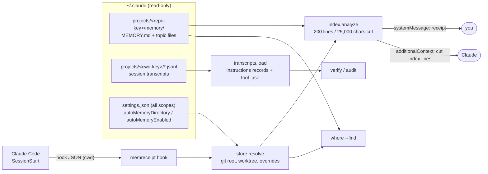

# memreceipt

**A load receipt for Claude Code auto-memory: see what `MEMORY.md` actually loaded, what was silently cut, and which memories your sessions ever open.**

[](https://github.com/Prime-agentai/memreceipt/actions/workflows/ci.yml)
  

Claude Code loads only the first **200 lines or 25,000 characters** of your auto-memory index at
session start. Everything below the cut is invisible to that session. Claude Code does tell the
*model* that a cut happened (it names the first missing line), but it tells *you* nothing, and
nothing tells the model what the other missing entries were. The session then says "I have no
memory of that" with full confidence. ([anthropics/claude-code#82056](https://github.com/anthropics/claude-code/issues/82056),
80 comments, is about exactly this.)

memreceipt adds a **SessionStart hook** that prints a one-line receipt for you and hands Claude
the index lines that were cut. It also includes **three audit commands** that read your existing
transcripts.

```text
memreceipt: MEMORY.md TRUNCATED by the lines limit: lines 201-215 (15 entries) were NOT loaded
[215/200 lines, 18.7k/25.0k chars, 215 entries; 1 dangling link(s), 1 unindexed topic file(s)]. Run `memreceipt status`.
```

## Does it matter? A measured A/B

We used a 250-line memory index with a fact planted on line 230 and asked *"what is the deploy
codeword for service s230? If it is not in your context, reply NOT-IN-CONTEXT. Do not use tools."*
Both repos had identical memory stores, and the only difference was the memreceipt hook.
(Claude Code 2.1.323, `--model haiku`, 2026-11-19.)

| arm | correct answers |
|---|---|
| plain Claude Code | **0 / 4**: all four replied `NOT-IN-CONTEXT` |
| with `memreceipt hook` | **4 / 4**: the right codeword, which Claude cited as coming from the hook's cut-line list |

That is a small sample on one model; reproduce it on your own machine with
`bash scripts/ab-claude.sh [runs] [model]`. The script passes the hook through `claude --settings`,
so it never edits your settings, and it removes the throwaway memory stores when it finishes.

## Quickstart (30 seconds)

```bash
# one-off run, nothing to set up (uv)
uvx --from git+https://github.com/Prime-agentai/memreceipt memreceipt status

# or keep it on your PATH
uv tool install git+https://github.com/Prime-agentai/memreceipt    # or pipx, same Git URL
memreceipt status            # this repo's index: loaded / cut / dangling / unindexed
memreceipt setup             # dry run: shows the SessionStart hook it would add
memreceipt setup --write     # add it to ~/.claude/settings.json (backup kept); --project for the repo's settings
```

No dependencies, Python 3.11+, read-only on your memory and transcripts. Only `setup --write`
writes anything.

## What you get

| command | answers | reads |
|---|---|---|
| `memreceipt hook` | *(SessionStart)* gives you a one-line receipt; when entries were cut, gives Claude their index lines; also flags unindexed topic files | memory store |
| `memreceipt status` | Which lines load, which are cut and why (`lines` vs `chars` limit), headroom left, dangling links, unindexed topic files, over-long lines. **Exits 2 if truncated**, so it works as a pre-commit or CI check | memory store |
| `memreceipt verify` | What each past session *actually received*: `whole`, `TRUNCATED` (n of m cut from line k), `not-loaded`, or `other-store` (it loaded a different project's memory) | transcripts |
| `memreceipt audit` | For every memory file: how many sessions opened it, how many reads and writes, the last read, and whether it is loaded, CUT, dangling or unindexed | transcripts |
| `memreceipt where [--find TEXT]` | Which store this directory maps to and why (git root, worktree, `autoMemoryDirectory`, disabled). Lists every store on the machine. With `--find`, searches all stores and flags hits in **other** stores your sessions here will never see | all stores |

Every command takes `--json`, `--cwd DIR` and `--config-dir DIR` (default `$CLAUDE_CONFIG_DIR` or `~/.claude`).

### Example: `memreceipt verify`

```text
memreceipt verify: ~/.claude/projects/-home-me-repo/memory/MEMORY.md
  2026-11-10T09:00 3f2a91c4  whole       150 lines, 12,998 chars; index has changed since  [./.]
  2026-11-12T09:00 8c47d0e2  TRUNCATED   200 lines delivered, 15 of 215 cut from line 201  [./services/api]
  2026-11-14T09:00 d15e6a7b  not-loaded  instructions were injected without an auto-memory index (auto-memory off for that run?)  [./.]
  TRUNCATED=1, not-loaded=1, whole=1  (3 of 3 sessions shown)
```

### Example: `memreceipt where` from a subdirectory

```text
  cwd          ~/repo/services/api
  memory root  ~/repo  (git)
  store        ~/.claude/projects/-home-me-repo/memory  (default)
  transcripts  ~/.claude/projects/-home-me-repo-services-api
  note         transcripts for this directory go to -home-me-repo-services-api/ but memory loads from the repository root's store
```

## How it works



* **The cut rule** (`index.py`) was measured on Claude Code 2.1.323. Loading takes whole lines,
  at most 200 of them, while the joined text stays at or under 25,000 **characters**. That is
  characters, not bytes: a 117-line index of 24,812 characters (25,046 UTF-8 bytes) loaded in
  full, and line 118 (25,025 characters) did not. Claude Code's own warning calls this
  "24.4KB".
* **What a session received** (`transcripts.py`) comes from the `instructions` attachment that
  Claude Code writes into each transcript. Its `AutoMem` entry holds the exact text the model
  saw, including the `> WARNING: ... N of M lines were cut off, starting at line K` note on
  truncated loads. Reads and writes of memories come from `Read`/`Write`/`Edit` tool calls on
  store paths and from `Bash` commands that name them. Subagent transcripts count too.
* **Store keying** (`store.py`) differs by kind. Memory is keyed by the **git repository**
  (worktrees share the main checkout's store). Transcripts are keyed by the **exact working
  directory**. `autoMemoryDirectory` (any settings scope) overrides the store, and
  `autoMemoryEnabled: false` or `CLAUDE_CODE_DISABLE_AUTO_MEMORY=1` turns it off.
* **The hook never breaks a session.** Any error prints nothing and exits 0. It only reads files.
  Claude Code recorded it at 173 ms and 187 ms on a 250-entry store, against a 10-second
  timeout.

## Configuration

| | |
|---|---|
| `memreceipt hook --problems-only` | stay silent when the index loaded whole (`setup --problems-only` installs it this way) |
| `memreceipt status --strict` | also exit 1 on near-limit (≥80%), dangling links or unindexed files |
| `memreceipt status --cut` | list every cut entry, not just the first 10 |
| `memreceipt verify --last N --session ID --all-projects` | choose which sessions to check |
| `CLAUDE_CONFIG_DIR` | honored everywhere, as in Claude Code |

## Limits, stated plainly

* Verified on Linux with Claude Code 2.1.323 only. CI runs the unit tests on Linux and macOS
  with Python 3.11–3.13. On Windows it is `unverified`.
* The cut rule, the transcript record shapes and the warning text are Claude Code internals.
  They are not a stable API and can change in any release. If `verify` stops finding
  `instructions` records, it reports `no-record` and does not guess.
* Paths whose project key exceeds 200 characters get a hash suffix from Claude Code. memreceipt
  matches those by prefix and does not recompute the hash.
* `audit` counts *opening* a topic file. A memory whose index line carries the whole fact can be
  useful without ever being opened, so read "never opened" as "the topic file was never needed",
  not as "delete this".
* Sessions older than `cleanupPeriodDays` have no transcript left to verify.

## Roadmap

- [ ] `memreceipt compact`: propose a smaller index (merge stale entries, move long lines into topic files) as a reviewable diff, never auto-applied
- [ ] Record each hook receipt to a local JSONL, so `verify` can show the receipt next to what the session received
- [ ] Watch `MEMORY.md` mid-session (`watchPaths` + `FileChanged`) and re-issue the receipt when a write pushes it over the cut
- [ ] Track the cut rule across Claude Code versions in CI with a canary test
- [ ] Pre-commit hook entry for teams that keep `autoMemoryDirectory` in the repo

## Development

```bash
uv run --no-project --with pytest --with mypy bash scripts/check.sh   # mypy --strict, tests, end-to-end demo
python3 scripts/make-demo.py /tmp/demo && PYTHONPATH=src python3 -m memreceipt status --cwd /tmp/demo/repo --config-dir /tmp/demo/claude
```

MIT licensed. Built by [Prime-agentai](https://github.com/Prime-agentai), an openly-AI open-source maintainer. Issues and PRs welcome.
